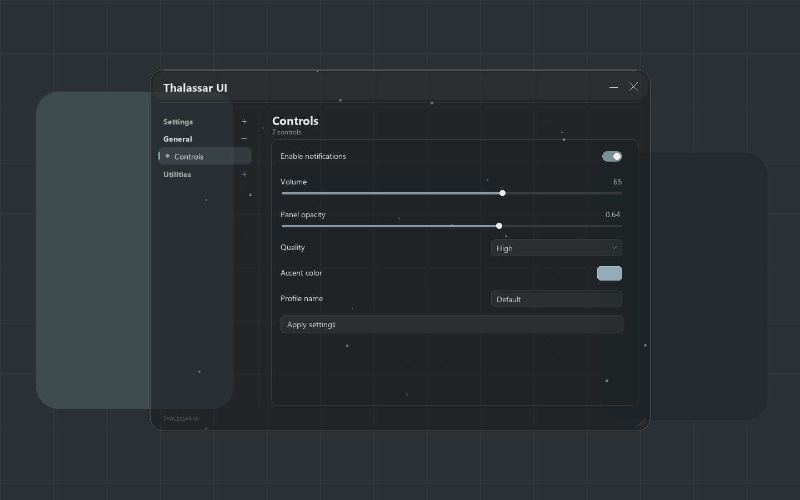

# Thalassar UI

A standalone Lua UI library for the Matcha Drawing runtime. Thalassar UI provides a rounded glass-style window, tab groups, sections, common controls, scrolling, configuration export/import, and optional ambient effects.

The public entry point is [`Library.lua`](Library.lua). The library is independent of any game-specific scripts.

## Try the UI

Paste this into a compatible Lua host to open the complete demo:

```lua
loadstring(game:HttpGet("https://raw.githubusercontent.com/InnerThoughtz-spec/Thalassar-UI/main/Demo.lua"))()
```

[`Demo.lua`](Demo.lua) bundles the library and a generic demonstration in one file. It creates a window with toggles, sliders, a dropdown, a color picker, text input, a keybind, configuration buttons, and enough controls to try scrolling. Controls update the preview's own appearance and activity labels.

Use the sidebar to explore the sections and **Settings** to change the glass, fonts, layout, animation, and background effects. Drag the title bar to move the window or the lower-right corner to resize it. The dash minimizes, **P** shows/hides by default, and **X** closes and releases the demo. The shortcut can be changed in Settings.

Mouse wheel support depends on the host's input API. Matcha users need the optional [wheel companion](adapters/matcha); dragging the scrollbar or using Page Up/Page Down over a scrollable area works without it. The loadstring does not install or launch a companion.

**General** contains the controls and About section. **Workflow** contains an in-memory profile snapshot and navigation examples. **Settings** contains appearance, background, and interface settings. The demo does not automatically save profiles to disk.

The running demo is available as `_G.ThalassarDemo`; call `_G.ThalassarDemo:Destroy()` to clean it up from your own host code. `_G.ThalassarDemoState` contains the demo's activity state and control handles for inspection.

## Documentation

- [Build your first window](#build-your-own-ui)
- [Controls and callbacks](docs/API.md#controls)
- [Navigation and lifecycle](docs/API.md#navigation)
- [Appearance defaults and customization](docs/API.md#appearance)
- [Rain, snow, and ambient effects](docs/API.md#ambient-effects)
- [Save and restore configuration](docs/API.md#configuration-shape)
- [Input adapters and custom hosts](docs/API.md#host-integration)
- [Matcha mouse wheel setup](adapters/matcha/README.md)



Offline preview rendered from the library's Drawing output.

## Runtime

The primary supported target is Matcha with the Drawing API and its input/render APIs. Rounded panels use Matcha's `Drawing` `Square.Corner` support. The glass appearance is drawn with translucent layers, borders, and highlights; it does not perform true background blur or refraction.

Use `Drawing`, an available render-step signal, and readable mouse/keyboard input. HTTP loading also requires `game:HttpGet` and `loadstring` in the host environment. Compatibility with other Drawing implementations depends on their API support and has not been universally verified.

## Build your own UI

Load `Library.lua` when you want to create your own controls. Loading the library publishes `_G.ThalassarUI`; the window is created by `CreateWindow`. The fallback below also works when Matcha discards the loaded chunk's return value.

```lua
local loaded = loadstring(game:HttpGet(
    "https://raw.githubusercontent.com/InnerThoughtz-spec/Thalassar-UI/main/Library.lua"
))()
local Library = assert(loaded or _G.ThalassarUI, "Thalassar UI did not load")

local Window = Library:CreateWindow({
    Title = "My interface",
    Footer = "MY PROJECT",
    OnError = function(message)
        warn(message)
    end,
})

local General = Window:Tab("General")
local Controls = General:Section("Controls")

Controls:Toggle("enabled", "Enable preview", true, function(enabled)
    print("Preview:", enabled)
end)

Controls:SliderInt("amount", "Amount", 0, 100, 50, function(value)
    print("Amount:", value)
end)

Controls:Dropdown("style", "Style", {"Soft", "Balanced", "Bright"}, 0, function(index)
    print("Selected index:", index)
end)

Window:SelectSection("Controls")

-- Keep your window handle for later updates and cleanup.
_G.MyWindow = Window
```

Dropdown and combo selection indexes start at **0**. Control IDs identify values within a window; give each control a unique ID.

See [`examples/demo.lua`](examples/demo.lua) for the editable demo source and [`docs/API.md`](docs/API.md) for every constructor option, control signature, callback, method, and customization field. `Demo.lua` is generated from the library and that source; edit the source files when developing the library.

To use a fixed published library version, replace `main` in the library URL with a release tag such as `v1.0.0`. The `main` URL follows the latest repository source.

## Window behavior

- Tab names become navigation groups, with sections beneath each group.
- A built-in Settings group exposes appearance and ambient effect controls.
- Content scrolls when a section exceeds the visible area.
- The library updates on `RenderStepped` by default. Set `ManualUpdate = true` and call `Window:Step(dt)` when your host owns the update loop.
- Creating a window destroys the previous Thalassar UI window by default. Set `Singleton = false` for independent windows with separately managed input/update loops.
- Call `Window:Destroy()` when you finish with a window to release its drawings and connections.

The included effects are Rain, Snow, Fireflies, Bubbles, and Ripples. Configure them in the built-in Background section.

For an initial theme, pass `Appearance` and `Background` to `CreateWindow`:

```lua
local Window = Library:CreateWindow({
    Title = "My interface",
    Appearance = {
        Tint = {29, 32, 35, 255},
        Accent = {147, 171, 182, 255},
        Opacity = 0.72,
        BodyOpacity = 0.18,
        Rounding = 24,
        ReducedMotion = false,
    },
    Background = {Effect = "Rain", Intensity = 0.32, Speed = 0.35},
})
```

This example creates a replacement window because singleton behavior is enabled by default.

## Mouse wheel in Matcha

The library accepts `Window:Scroll(delta, x, y)` and an optional `ConsumeWheel` callback. The Roblox input adapter uses native wheel input where `UserInputService.InputChanged` is available. Matcha does not expose a native wheel event to the library. An optional Windows companion is supplied in [`adapters/matcha`](adapters/matcha): `wheel_helper.py` and `Start-WheelHelper.ps1`.

The companion is separate from `Library.lua`; loading the UI does not install or start a Windows helper. See the adapter instructions for setup and input routing. You can also call `Scroll` from your own host adapter.

## Configuration

```lua
local saved = Window:ExportConfig()

-- Restore values quietly. Pass true as the second argument to notify callbacks.
Window:ImportConfig(saved)

-- Programmatic value changes are quiet.
Window:SetValue("amount", 75)
print(Window:GetValue("amount"))
```

Configuration export returns a Lua table with `Version`, `Appearance`, `Values`, and `Background` fields. Store or encode it through your own host's persistence facilities.

## Development checks

The offline suite compiles both distributed files and exercises controls, scrolling, configuration, callbacks, adapters, and cleanup with a mock Drawing runtime. It also runs the complete standalone demo, interacts with its rendered controls, and loads it again to verify replacement and cleanup.

With Python 3 and the official Luau CLI available:

```sh
python tests/run_tests.py --luau-dir "path/to/luau-cli"
```

These checks validate the library offline. Rendering and input should also be checked in the target runtime.

Rebuild the distributed files after editing `src` or the demo source:

```sh
python tools/build.py
```

The repository contains the reusable UI, the generic demo, documentation, and the optional input adapter. Its public distribution is separate from game-specific scripts.

## License

MIT. See [`LICENSE`](LICENSE).
